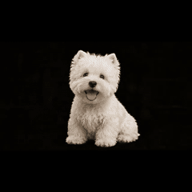
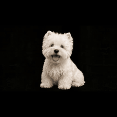
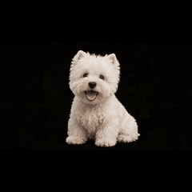
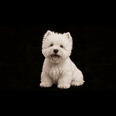
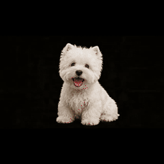
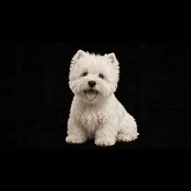
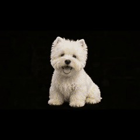
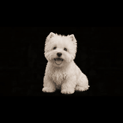
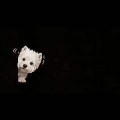

# xiaozhi-esp32-modified — HachimoDock 西高地小狗（Movecall Moji 板）

这是 [78/xiaozhi-esp32](https://github.com/78/xiaozhi-esp32) 的一个改造分支，基线为上游提交 `aaf1eb7`（2026-11-16）。目标只有一个：把 [HachimoDock](https://github.com/ai-maker-lab/HachimoDock) 的西高地小狗搬到小智的 Movecall Moji 开发板（`movecall-moji-esp32s3`，GC9A01 圆形 240×240 屏）上，正常使用时屏幕只显示小狗，不出现小智自带的 UI。

上游小智项目本身的介绍、支持的开发板、MCP 等内容请看上游仓库；这里只写本分支改了什么。同步上游的方法见 [TERRIER_SYNC.md](TERRIER_SYNC.md)。

## 改了什么

### 1. 小狗动画：12 段 GIF，替代默认 Noto 表情

小狗动画放在 `main/assets/emoji/terrier/`，共 12 段，全部 240×240、8fps、32 色，合计约 6.3MB：

| 预览 | 表情 | 触发 |
| --- | --- | --- |
|  | neutral | 待机 / 连接中 |
|  | listening | 正在聆听 |
|  | speaking | 正在说话 / 通知 |
|  | thinking | 服务端下发 `llm` 情绪 `thinking` |
|  | happy | 服务端下发 `llm` 情绪 `happy` |
|  | surprised | 服务端下发 `llm` 情绪 `surprised` |
|  | error | 出错 |
|  | eating | 待机轮播 |
|  | daydreaming | 待机轮播 |
|  | playing | 待机轮播 |
|  | begging | 待机轮播 |
|  | welcome | 开机后第一次进入待机时播放一次 |

表情名就是 GIF 文件名；服务端 `llm` 情绪和 `Alert()` 透传名字即可触发对应动画。

**去掉的 4 段**：reading、traveling、browsing、done。原因是资源分区只有 8MB 上限，12 段 GIF（6,556,112 字节）加其他资源约 1,579,967 字节，总计 8,136,619 字节，余量约 250KB，再加就超了。

### 2. 纯狗界面：正常使用只显示小狗

- 不显示时钟
- 不显示聊天记录
- 不显示顶部栏、状态栏（待机等字样）、底部栏

只保留小狗全屏显示。

### 3. 待机轮播：待机动作轮流播放

开机后第一次进入待机先播放一次 `welcome`，之后在待机状态下按顺序轮播：

neutral → eating → daydreaming → playing → begging → neutral → …

每段播完一整遍才切换（neutral / eating / daydreaming / playing / welcome 各 9 秒，begging 7 秒），不会播一半被切断。离开待机或出现错误提示时轮播复位。

### 4. 中文 + 唤醒词

- 界面语言：中文（zh-CN）
- 唤醒词：你好小智

### 5. 开关

`CONFIG_PET_TERRIER_EMOTIONS`（默认开启，仅对 Moji 板生效），位置在 `main/Kconfig.projbuild`。改动基本都包在这个开关里，关掉后恢复上游行为。注意：`DEFAULT_EMOJI_COLLECTION` 被固定设为 `terrier`，所以关掉开关并不会把表情换回默认的 Noto。

## 编译与烧录

编译（ESP-IDF release/v6.1）：

```bash
python3 scripts/build.py movecall/moji-esp32s3 --language zh-CN --wake-word nihaoxiaozhi
```

烧录用 [ESP Launchpad](https://espressif.github.io/esp-launchpad/)（Chrome，DIY 模式），只烧两个文件，NVS 不动，WiFi 设置保留：

| 文件 | 地址 |
| --- | --- |
| `build/xiaozhi.bin` | `0x20000` |
| `build/generated_assets.bin` | `0x800000` |

如果板子当前跑在 ota_1 分区、烧完仍显示旧版本，把 `xiaozhi.bin` 改烧到 `0x410000`。

## 改动文件

| 文件 | 改动 |
| --- | --- |
| `main/assets/emoji/terrier/*.gif` | 新增 12 段小狗 GIF |
| `main/application.cc`、`.h` | 待机轮播逻辑（welcome 一次 + 五段循环） |
| `main/display/lcd_display.cc` | 非微信分支隐藏顶部栏 / 状态栏 / 底部栏，并守住两处会重新显示底部栏的地方 |
| `main/display/lvgl_display/lvgl_display.cc` | 小狗模式下不显示待机时钟 |
| `main/CMakeLists.txt` | Moji 板默认表情集改为 `terrier`，本地表情集参与资源打包 |
| `scripts/build_default_assets.py` | 优先收集 `main/assets/emoji/<名字>` 下的本地表情集 |
| `main/Kconfig.projbuild` | 新增 `CONFIG_PET_TERRIER_EMOTIONS` 开关 |
| `main/boards/movecall/moji-esp32s3/README.md` | Moji 板说明中加入小狗相关内容 |
| `TERRIER_SYNC.md` | 同步手册：基线、改动清单、同步上游的步骤 |
